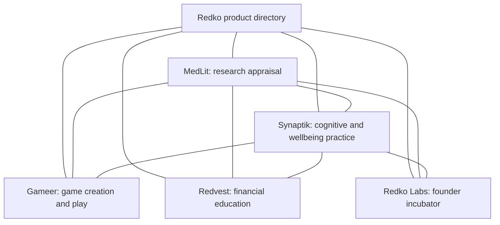

# Redko product navigation map

Updated October 13, 2026. Scope: useful navigation between distinct products, clear descriptions and crawlable links. This does not merge accounts or data.

## Visitor routes

The map is the intended product navigation, not a legal ownership graph. A product About page explains the relationship and describes related projects. A short About Redko footer link leads there. Keep task-specific links close to relevant content; avoid stuffing every article with all brands.

## Destinations and migration

| Product | Public destination | Current status |
| --- | --- | --- |
| Redko | https://www.theredko.com/products | Existing public Wix directory, already links MedLit and Synaptik |
| Redko Labs | https://redko-website-preview.vercel.app/RedkoLabs | Working Vercel review page, noindex during migration |
| MedLit | https://medlit-evidence-appraisal.vercel.app/about#redko | Directory implemented in this release |
| Synaptik | https://synaptik-beta.vercel.app/about#redko | New directory implemented in this release |
| Gameer | https://www.gameer.io/about | Reciprocal directory integration pending |
| Redvest | https://www.redvest.app/about | Existing public links; new Vercel site integration pending |

Use the verified www.theredko.com domain, not an assumed redko.com destination. The existing www.theredko.com/RedkoLabs path returns 404. Keep the working Labs Vercel URL until the domain migration owner confirms the canonical route, redirects and indexing settings. Preserve Vercel aliases after custom domains go live.

## Search and AI readability

- Visible HTML anchors and concise descriptions are the primary discovery path.
- AboutPage and ItemList structured data describe the visible directory. Separate products are not sameAs aliases of one organization.
- Synaptik /about is included in its sitemap. MedLit /about already was.
- Both products publish the same factual directory in llms.txt and redko-network.json; these files are supplemental and do not guarantee AI inclusion.
- No ranking, traffic or indexing improvement is claimed from implementation alone.
- Check destination status, rendered links, mobile layout, canonical and JSON-LD after each migration.

References: https://developers.google.com/search/docs/crawling-indexing/links-crawlable and https://developers.google.com/search/docs/appearance/ai-features.
