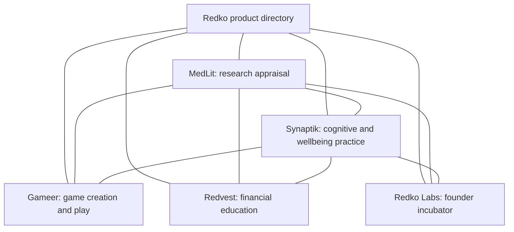

# Redko product navigation map

Updated October 13, 2026. Scope: useful navigation between distinct products, clear descriptions and crawlable links. This does not merge accounts or data.

## Visitor routes

The map is the intended product navigation, not a legal ownership graph. A product About page explains the relationship and describes related projects. A short About Redko footer link leads there. Keep task-specific links close to relevant content; avoid stuffing every article with all brands.

## Destinations and migration

| Product | Public destination | Current status |
| --- | --- | --- |
| Redko | https://www.theredko.com/products | Existing public Wix directory, already links MedLit and Synaptik |
| Redko Labs | https://redko-website-preview.vercel.app/RedkoLabs | Working Vercel review page, noindex during migration |
| MedLit | https://medlit-evidence-appraisal.vercel.app/about#redko | Directory implemented in this release |
| Synaptik | https://synaptik-beta.vercel.app/about#redko | New directory implemented in this release |
| Gameer | https://www.gameer.io/about | Reciprocal directory live on Gameer About |
| Redvest | https://www.redvest.app/about | Existing public links; Vercel integration applied locally, deployment pending |

Use the verified www.theredko.com domain, not an assumed redko.com destination. The existing www.theredko.com/RedkoLabs path returns 404. Keep the working Labs Vercel URL until the domain migration owner confirms the canonical route, redirects and indexing settings. Preserve Vercel aliases after custom domains go live.

## Search and AI readability

- Visible HTML anchors and concise descriptions are the primary discovery path.
- AboutPage and ItemList structured data describe the visible directory. Separate products are not sameAs aliases of one organization.
- Synaptik /about is included in its sitemap. MedLit /about already was.
- Both products publish the same factual directory in llms.txt and redko-network.json; these files are supplemental and do not guarantee AI inclusion.
- No ranking, traffic or indexing improvement is claimed from implementation alone.
- Check destination status, rendered links, mobile layout, canonical and JSON-LD after each migration.

References: https://developers.google.com/search/docs/crawling-indexing/links-crawlable and https://developers.google.com/search/docs/appearance/ai-features.

## Delivery and verification

- MedLit: runtime e0c97a9, published at https://medlit-evidence-appraisal.vercel.app. Production About links, canonical and directory schema verified; five destinations returned 200. Follow-up browser checks identified a client-router fragment-scroll defect; native web anchors replace the affected links.
- Synaptik: runtime fc98f97, published at https://synaptik-beta.vercel.app. Pause/play icon changes actual video state; keyboard activation and 390 by 667 layout checked. Science typography verified in the app and public page. Locally hosted Source Sans 3 bytes match deployment. Five directory destinations returned 200 and /about is in the sitemap.
- Gameer: runtime d7c41b5 on branch codex/redko-navigation-20261013, pushed to redkoai/gameer-landing and published at https://www.gameer.io/about#redko. Based on the verified current production 034c310, with only four runtime files changed. Static quality gate passed; hosted build, critical auth/signup/API tests and 751 static pages passed. Full TypeScript and Playwright suites were skipped by the existing production pipeline. Actual browser checks covered desktop, phone width and navigation to MedLit.
- Redko/Labs: runtime fb7818d, also integrated into Redko main as db96758. Published to https://redko-website-preview.vercel.app/products. 48 tests and 3,489 internal links passed before the Labs homepage follow-up; the link check passed again afterward. Both Labs homepage and program page expose the related product links. Backend health flags match the previous release. Public Wix domain still unchanged; Vercel review remains noindex.
- Redvest: four-file integration applied locally in /Users/anyaozmen/Downloads/redvestRN/website. TypeScript passed. An isolated local Next preview verified the directory and keyboard footer navigation on a 390 by 667 viewport. Not deployed here because a separate active assessment/certificate release owns that website deployment. Complete scoped patch is in Synaptik docs/release/redvest-product-navigation.patch. Existing public Wix About links to MedLit/Synaptik remain live.

No new personal-data collection, account sharing, analytics-consent changes, auth changes or database writes were introduced. No ranking or AI-inclusion improvement has been measured. The reduced-motion default is retained in source; an OS-level reduced-motion test was not performed in this pass.
